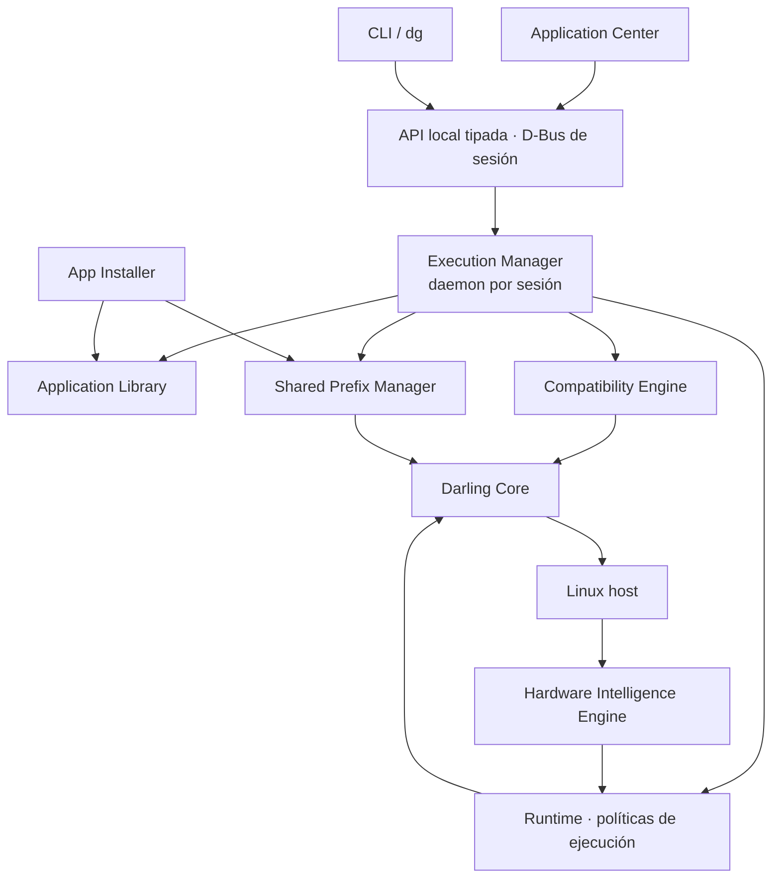

# Darling Platform

Plataforma para **importar, instalar, administrar y ejecutar aplicaciones de
macOS en Linux**, usando [Darling](https://github.com/darlinghq/darling) como
núcleo de compatibilidad y construyendo alrededor de él la gestión, el
diagnóstico, la integración con el escritorio y los perfiles de ejecución.

> **Estado actual: esqueleto compilable.** El repositorio todavía no ejecuta ni
> instala aplicaciones. Lo que existe hoy es el andamiaje que hace verificable
> cada paso siguiente: workspace de Cargo con los límites de los módulos
> declarados, build de CMake, CI, documentación de arquitectura y las primeras
> decisiones registradas como ADR.

**Darling Platform** es un nombre de trabajo. La decisión sobre el nombre
definitivo y la organización de repositorios sigue abierta.

## Qué resuelve

El proyecto persigue dos objetivos separados y explícitos:

1. **Compatibilidad general**: aplicaciones de productividad, desarrollo, diseño
   y multimedia.
2. **Compatibilidad especializada para videojuegos**: perfiles gráficos, entrada,
   audio, rendimiento y pruebas propias, como edición o runtime sobre el mismo
   núcleo.

La regla que ordena todo lo demás: **una aplicación instalada no es una
aplicación compatible**. La plataforma reporta qué se detectó, qué se comprobó y
qué sigue siendo desconocido.

## Principios

- **Reutilizar Darling.** La plataforma lo integra y administra; no reimplementa
  sus subsistemas. Las mejoras genéricas se proponen upstream.
- **Un único DPREFIX dedicado y compartido** por usuario, en
  `~/.local/share/darling-platform/prefix/`. Nunca un prefijo por aplicación.
- **Un daemon de ejecución por sesión de usuario**, con operaciones tipadas. El
  frontend no envía comandos de shell arbitrarios.
- **La detección describe; el runtime decide.** El motor de hardware no elige
  GPU ni backend: publica evidencia con diagnósticos parciales.
- **Dedicated GPU First.** Con GPU dedicada e integrada, la dedicada renderiza y
  la integrada se conserva para pantallas y sistemas híbridos.
- **Sin root y sin tocar el host.** No se instalan drivers ni se modifica la
  configuración del sistema automáticamente; los bundles y archivos son entrada
  no confiable.

Los detalles y las consecuencias de cada principio están en
[`PLAN_DARLING_PLATFORM.md`](PLAN_DARLING_PLATFORM.md) y en los
[ADR](docs/architecture/decisions/).

## Arquitectura en una imagen



El detalle por capa está en
[`docs/architecture/overview.md`](docs/architecture/overview.md); el recorrido de
datos de una importación y de un lanzamiento, en
[`docs/architecture/data-flow.md`](docs/architecture/data-flow.md).

## Mapa del repositorio

| Ruta | Contenido |
| --- | --- |
| `apps/cli/` | Crate `dp-cli` y binario `dg`: versión y ayuda. Sin comandos todavía. |
| `modules/platform-common/` | Límite del módulo de identificadores, errores y diagnósticos compartidos. |
| `modules/hardware-intelligence/` | Límite del DHI: descubrimiento, no decisión. |
| `modules/shared-prefix/` | Límite del ciclo de vida y los locks del DPREFIX. |
| `modules/compatibility-engine/` | Límite del análisis de requisitos y evidencias. |
| `modules/application-management/` | `app-installer`, `app-library` y `bundle-inspector`. |
| `services/execution-manager/` | Límite del daemon de sesión. |
| `cmake/` | `Rust.cmake`: CMake orquesta, Cargo compila. |
| `docs/architecture/` | Visión general, componentes, flujos de datos y ADR. |
| `odd/tasks/` | Documentos de trabajo por feature: specs, tareas y bitácora. |
| `scripts/` | `dev/env-check.sh` y `ci/check.sh`. |
| `tests/`, `packaging/`, `integrations/`, `runtimes/` | **Aún no existen**: se crean con su primera implementación verificable. |

Los crates de los módulos están deliberadamente vacíos: declaran su
responsabilidad y su no-responsabilidad en la documentación del crate para que el
límite sea revisable antes de que exista código. La estructura objetivo del plan
es una dirección, no una obligación de crear directorios vacíos.

## Requisitos

- Linux x86-64 (AArch64 se prepara, no se promete).
- Rust **1.85** o superior (edición 2024) con `rustfmt` y `clippy`.
- CMake **3.20** o superior; Ninja es opcional y recomendado.
- Ningún paso de compilación, escaneo o ejecución requiere root.

Comprobación del entorno:

```bash
scripts/dev/env-check.sh
```

## Compilar y verificar

Cargo, para los crates:

```bash
cargo test --workspace            # pruebas
cargo run --bin dg -- --version    # CLI
```

CMake, para el árbol completo (construye con Cargo dentro de `build/cargo`):

```bash
cmake -S . -B build -G Ninja
cmake --build build
ctest --test-dir build --output-on-failure
cmake --install build --prefix /tmp/dp-prefix
```

Todas las compuertas de CI, en el mismo orden:

```bash
scripts/ci/check.sh
```

Las opciones de build (`DP_CARGO_PROFILE`, `DP_CARGO_TARGET_DIR`), la convención
de commits y el proceso para agregar un crate están en
[`DEVELOPMENT.md`](DEVELOPMENT.md).

## Documentación

- [`PLAN_DARLING_PLATFORM.md`](PLAN_DARLING_PLATFORM.md) — decisiones de producto
  y arquitectura, fases y criterios de salida.
- [`DEVELOPMENT.md`](DEVELOPMENT.md) — entorno, build, pruebas y convenciones.
- [`CONTRIBUTING.md`](CONTRIBUTING.md) — flujo de contribución y checklist de PR.
- [`SECURITY.md`](SECURITY.md) — modelo de amenaza y reporte de vulnerabilidades.
- [`docs/architecture/`](docs/architecture/) — visión general, componentes, flujos
  y ADR.
- [`CHANGELOG.md`](CHANGELOG.md) — cambios por versión.

## Licencia

GPL-3.0-or-later. Ver [`LICENSE`](LICENSE). Darling es un proyecto separado con su
propia licencia; consultar su repositorio antes de redistribuir un binario que lo
incluya.
