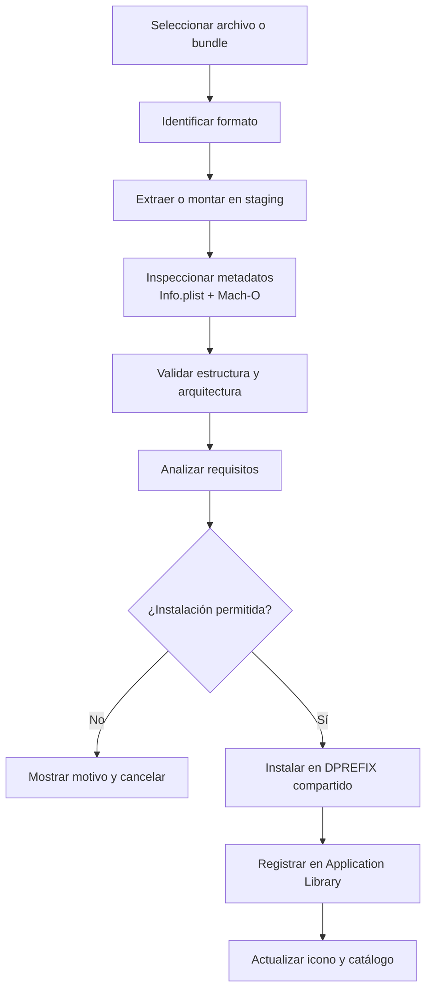
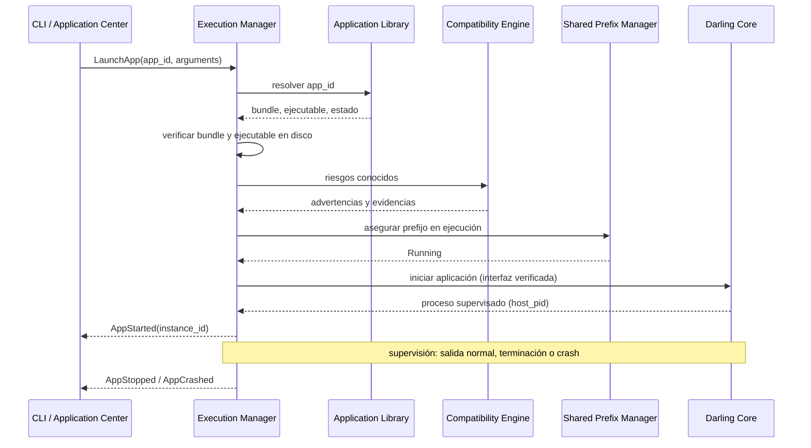
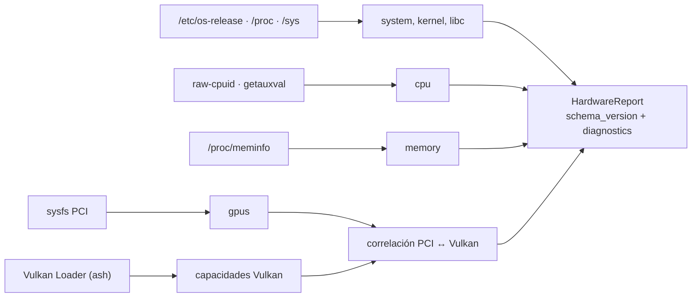
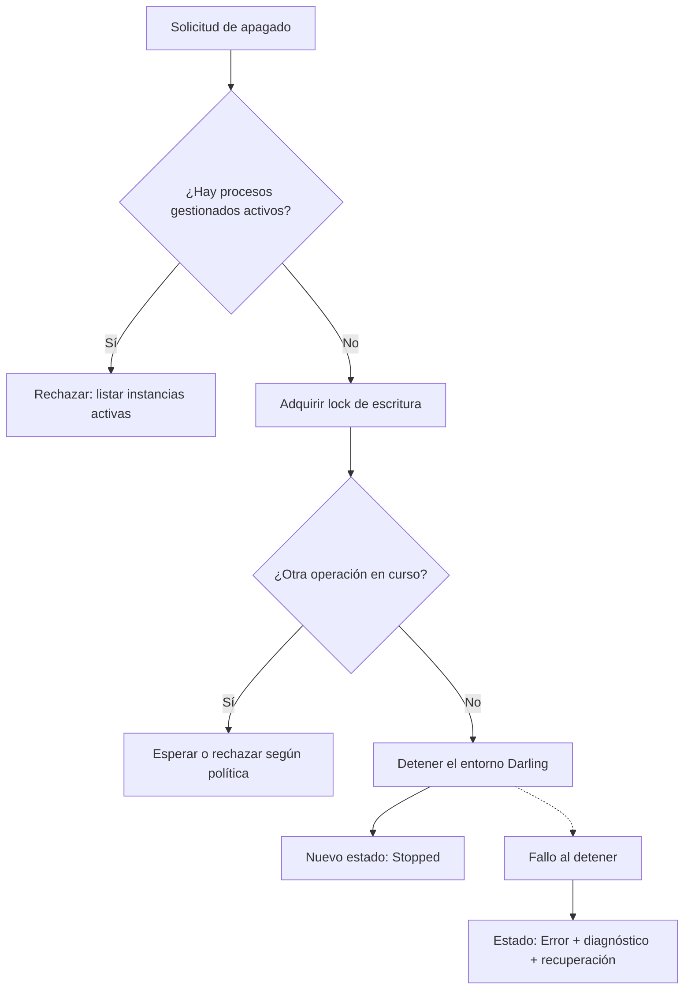

# Flujos de datos

Cómo viaja la información en los dos recorridos que definen el MVP: **importar una
aplicación** y **lanzarla**. Al final, el escaneo de hardware y el apagado del
prefijo, que son las dos operaciones que pueden dejar el sistema en un estado
inconsistente si se hacen mal.

Los diagramas describen el comportamiento esperado; todavía no hay
implementación.

## 1. Importación e instalación



Puntos donde se pierde información o se puede romper el sistema:

| Etapa | Qué se conserva | Qué se valida | Qué puede fallar |
| --- | --- | --- | --- |
| Identificación | Formato detectado y ruta de origen | Extensión y contenido, no solo el nombre | Formato no soportado por la versión de Darling |
| Staging | Copia temporal aislada | Rutas dentro del destino, symlinks, permisos | Path traversal, archivo corrupto, espacio insuficiente |
| Inspección | Metadatos y arquitecturas | Rutas declaradas dentro del bundle, ejecutable presente | `Info.plist` inválido, Mach-O truncado |
| Análisis | Evidencias y desconocidos | Requisitos contra el perfil de capacidades | Framework o API no soportada |
| Instalación | Historial con origen, versión y resultado | Lock de escritura del prefijo | Colisión con instalación existente |
| Registro | Fila en `applications` + historial | Consistencia con lo instalado | Fallo de escritura en SQLite |

Reglas que aplican a todo el recorrido:

- **Nada se instala sin staging previo.** Un fallo no puede dejar una instalación
  parcial silenciosa.
- **El consentimiento es explícito** cuando el formato puede ejecutar scripts
  (PKG), y la advertencia dice que el rollback puede ser incompleto.
- **El origen se registra siempre**, incluso si la instalación falla: el historial
  es la evidencia de qué se intentó.

## 2. Lanzamiento y supervisión



Decisiones que este flujo hace visibles:

- **`host_pid` es un proceso Linux.** No es un PID dentro del entorno Darwin y no
  debe presentarse como tal.
- **La compatibilidad se consulta antes de lanzar, no después.** Si el análisis
  dice "no compatible", el usuario ve la razón y decide con información.
- **El prefijo se mantiene vivo mientras haya procesos gestionados.** El daemon no
  apaga el entorno con aplicaciones activas.
- **Un crash no es un estado terminal del sistema.** El proceso se marca `Crashed`,
  se registra el diagnóstico y el prefijo sigue disponible.

## 3. Escaneo de hardware



- Cada proveedor corre aislado: su fallo agrega un diagnóstico y marca el reporte
  como `Partial`, no lo invalida.
- `scan_status` refleja la cobertura real: `Complete`, `Partial` o `Failed`.
- El reporte no selecciona GPU ni backend; solo describe. La política Dedicated GPU
  First se aplica en el runtime.

## 4. Apagado del prefijo



El apagado es la operación más destructiva del ciclo de vida: interrumpe trabajo y
puede dejar el prefijo inconsistente. Por eso exige lock de escritura, estado
explícito y diagnóstico cuando falla.

## 5. Directorios de usuario

```text
~/.local/share/darling-platform/
├── prefix/                     # DPREFIX compartido, administrado por Darling
├── apps/
│   ├── registry.sqlite         # catálogo
│   ├── icons/
│   ├── cache/
│   └── staging/                # temporal; nunca es destino final
├── logs/
│   ├── execution/
│   ├── installation/
│   └── daemon/
└── config/
    ├── runtime.json
    └── applications.json
```

Configuración y preferencias pueden vivir en `~/.config/darling-platform/` según
XDG Base Directory Specification.

Reglas:

- **Los datos de la plataforma no entran en el DPREFIX.** Catálogo, iconos, logs y
  configuración quedan fuera.
- **El prefijo no se mueve ni se copia con Darling activo.** La documentación de
  backup y recuperación es parte del trabajo del Shared Prefix Manager, no un
  apéndice opcional.
- **El staging se limpia.** Un staging huérfano ocupa espacio y confunde el
  diagnóstico; su recuperación es parte del ciclo de instalación.
