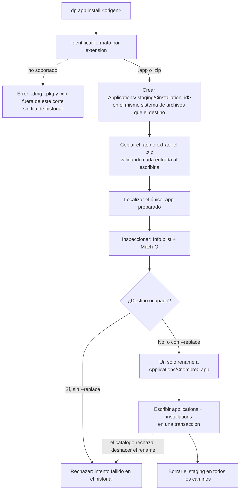
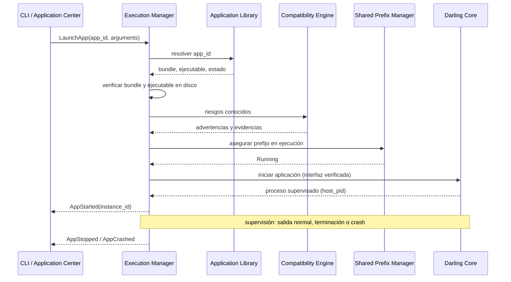
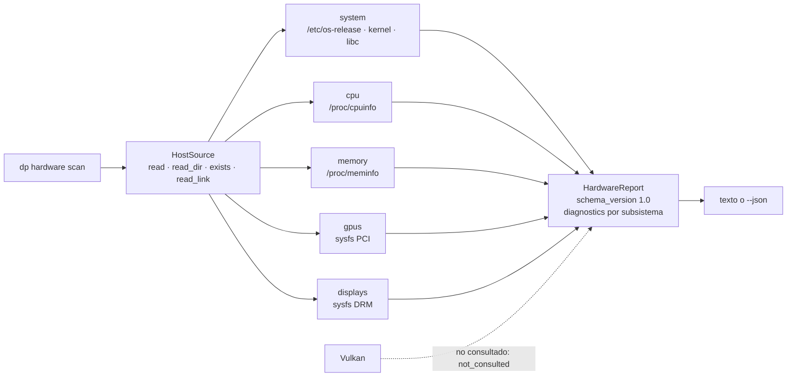
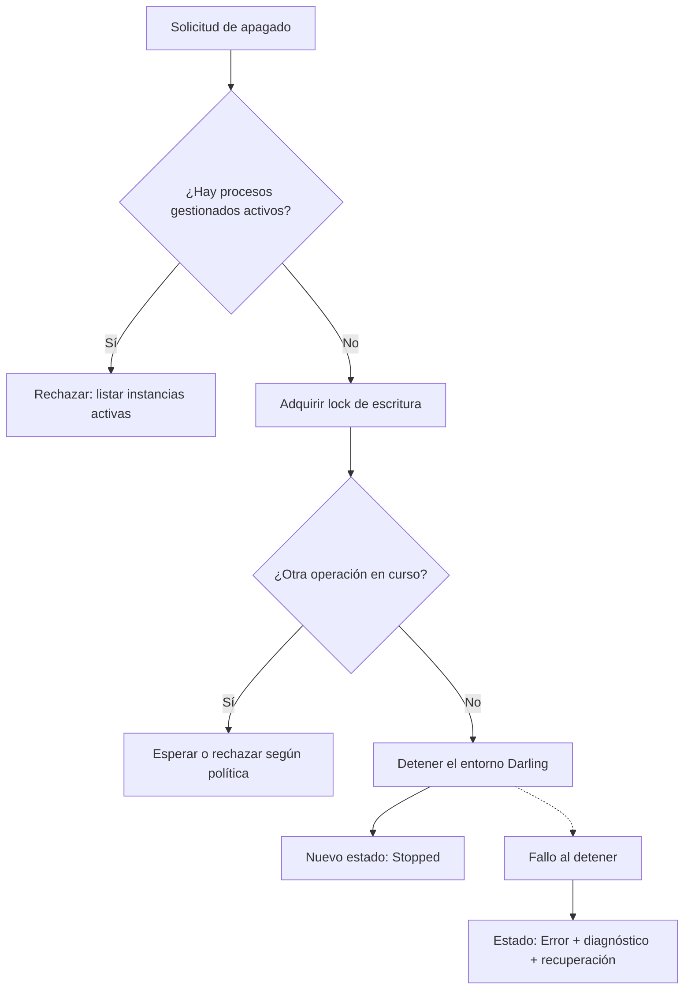

# Flujos de datos

Cómo viaja la información en los dos recorridos que definen el MVP: **importar una
aplicación** y **lanzarla**. Al final, el escaneo de hardware y el apagado del
prefijo, que son las dos operaciones que pueden dejar el sistema en un estado
inconsistente si se hacen mal.

Los diagramas describen el comportamiento esperado. La importación (§1), el
escaneo de hardware (§3) y el apagado del prefijo (§4) están implementados; el
lanzamiento (§2) todavía no.

## 1. Importación e instalación

Este recorrido está implementado: describe lo que hacen hoy `dp app inspect`,
`dp app install` y `dp app list`. Detalle en
[`application-install.md`](application-install.md).



Puntos donde se pierde información o se puede romper el sistema:

| Etapa | Qué se conserva | Qué se valida | Qué puede fallar |
| --- | --- | --- | --- |
| Identificación | Formato por extensión y ruta de origen | Solo la extensión: el contenido no se adivina | Formato fuera de este corte |
| Staging | Copia aislada en `Applications/.staging/<id>` | Que `installation_id` sea un componente de ruta; rutas, enlaces y tamaños al copiar | Path traversal, enlace que sale del bundle, ZIP por encima de los límites |
| Inspección | Metadatos, arquitecturas, frameworks y recursos | Rutas declaradas dentro del bundle, ejecutable presente y Mach-O legible | `Info.plist` inválido o de tipo equivocado, ejecutable ausente |
| Destino | Nombre saneado y ruta final | Que el nombre sea un solo componente y que el destino no esté ocupado sin `--replace` | Colisión con una instalación existente |
| Instalación | Un único `rename` entre sistemas de archivos iguales | Que el staging y el destino compartan sistema de archivos | Segundo `rename` fallido; restitución fallida |
| Registro | Fila en `applications` + fila en `installations` | Consistencia con lo instalado, en una transacción | Fallo de escritura en SQLite; id de intento repetido |
| Limpieza | Nada: el staging se borra siempre | Que no quede directorio de staging ni copia parcial | Un staging huérfano que ocupa espacio |

Reglas que aplican a todo el recorrido:

- **Nada se instala sin staging previo.** El staging vive en el mismo sistema de
  archivos que el destino, así que la instalación es un solo `rename` y un fallo
  no puede dejar una instalación parcial silenciosa.
- **El historial se escribe siempre**, también cuando la instalación falla: la
  fila lleva `result = failed`, sin `application_id` y con el motivo en `detail`.
  Solo un origen con formato no soportado no es un intento y no deja fila.
- **No se sobrescribe nada en silencio.** Un destino ocupado se rechaza salvo
  `--replace`, que intercambia las copias y actualiza la fila en lugar de
duplicarla.
- **El lock de escritura del prefijo se toma antes de escribir.** `dp app install`
  falla con `PrefixBusy` si otra operación lo tiene.
- **El análisis de compatibilidad no corre en este corte.** El instalador
  registra lo que el bundle declara, no decide si puede ejecutarse.
- **Nada se ejecuta.** Ni el binario del bundle ni scripts de instalador: por eso
  `.pkg` está fuera hasta tener su propio flujo con consentimiento explícito.

## 2. Lanzamiento y supervisión



Decisiones que este flujo hace visibles:

- **`host_pid` es un proceso Linux.** No es un PID dentro del entorno Darwin y no
  debe presentarse como tal.
- **La compatibilidad se consulta antes de lanzar, no después.** Si el análisis
  dice "no compatible", el usuario ve la razón y decide con información.
- **El prefijo se mantiene vivo mientras haya procesos gestionados.** El daemon no
  apaga el entorno con aplicaciones activas.
- **Un crash no es un estado terminal del sistema.** El proceso se marca `Crashed`,
  se registra el diagnóstico y el prefijo sigue disponible.

## 3. Escaneo de hardware

Este recorrido está implementado: describe lo que `dp hardware scan` hace hoy.



- `HostSource` es lo único que toca el sistema de archivos. En ejecución real es
  `LinuxHost`; en pruebas es un `MappingSource` con un host capturado, así que los
  parsers se validan con fixtures y no con la máquina que corre los tests.
- Cada proveedor corre aislado: su fallo agrega un diagnóstico y marca el reporte
  como `Partial`, no lo invalida. `Failed` queda reservado para cuando no se pudo
  describir la identidad del host en absoluto.
- `scan_status` refleja la cobertura real: `Complete` cuando ningún diagnóstico
  supera el nivel informativo, `Partial` cuando algo se degradó y `Failed` cuando
  distribución, kernel y libc quedaron los tres ausentes.
- El reporte se serializa con reglas fijas: enums en `snake_case`, ausencias
  omitidas en lugar de `null` y colecciones siempre presentes. Ver
  [`hardware-report.md`](hardware-report.md).
- **Vulkan no se consulta en este corte**: no hay loader, ni dispositivos, ni la
  correlación PCI con Vulkan. La ausencia se declara con el diagnóstico
  informativo `not_consulted` y no cambia el estado del reporte.
- El escaneo no requiere root y no escribe nada: solo lee rutas absolutas y
  resuelve enlaces de sysfs para conocer el driver enlazado.
- El reporte no selecciona GPU ni backend; solo describe. La política Dedicated GPU
  First se aplica en el runtime.

## 4. Apagado del prefijo



El apagado es la operación más destructiva del ciclo de vida: interrumpe trabajo y
puede dejar el prefijo inconsistente. Por eso exige lock de escritura, estado
explícito y diagnóstico cuando falla.

## 5. Directorios de usuario

```text
~/.local/share/darling-platform/
├── prefix/                     # DPREFIX compartido, administrado por Darling
│   └── Applications/           # bundles instalados: <nombre>.app
│       └── .staging/           # temporal; nunca es destino final
├── prefix.lock                 # lock del Shared Prefix Manager, fuera del prefijo
├── state.json                  # estado persistido del ciclo de vida
├── library.sqlite3             # catálogo: applications e installations
├── icons/                      # previsto: iconos convertidos
├── cache/                      # previsto
├── logs/                       # previsto
└── config/                     # previsto
```

Implementado hoy: el prefijo, su lock y su estado, el catálogo en
`library.sqlite3`, los bundles en `prefix/Applications/` y el staging en
`prefix/Applications/.staging/`. Los iconos, la caché, los logs y la
configuración todavía no existen: el catálogo guarda la ruta del `.icns` que
está dentro del bundle instalado, no una copia convertida.

Reglas:

- **Los datos de la plataforma no entran en el DPREFIX.** Catálogo, lock, estado,
  iconos, logs y configuración quedan fuera. La única excepción son los bundles
  instalados, que van a `<prefijo>/Applications/` porque ese es el destino que
  Darling lee, y el staging, que vive ahí para compartir sistema de archivos con
  el destino y poder instalarse con un solo `rename`.
- **El prefijo no se mueve ni se copia con Darling activo.** La documentación de
  backup y recuperación es parte del trabajo del Shared Prefix Manager, no un
  apéndice opcional.
- **El staging se limpia.** La guarda del staging lo borra en todos los caminos
  de salida, así que un staging huérfano solo puede quedar tras un corte abrupto
  del proceso; el siguiente intento con el mismo `installation_id` lo reemplaza.
- **Configuración y preferencias** pueden vivir en `~/.config/darling-platform/`
  según la XDG Base Directory Specification.
