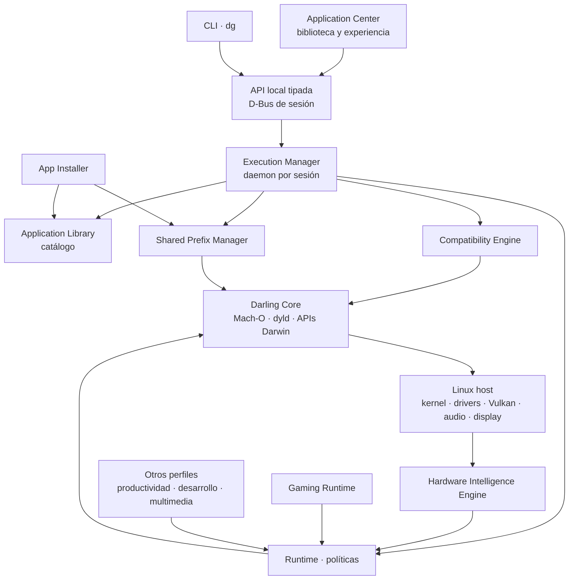

# Visión general de la arquitectura

Este documento describe **cómo está dividida la plataforma y por qué**. Las
decisiones que sostienen esa división están registradas en
[`decisions/`](decisions/); el detalle de cada componente, en
[`components.md`](components.md); el recorrido concreto de una importación y de un
lanzamiento, en [`data-flow.md`](data-flow.md).

El plan completo, con fases y criterios de salida, es
[`PLAN_DARLING_PLATFORM.md`](../../PLAN_DARLING_PLATFORM.md).

## Idea central

Darling ya resuelve la compatibilidad macOS. La plataforma **no** reimplementa
Mach, dyld, el runtime Objective-C ni los servicios Darwin: administra un entorno
Darling, describe el host, analiza aplicaciones con evidencia y decide cómo
lanzarlas.

De ahí salen las dos separaciones que ordenan todo el diseño:

1. **Describir no es decidir.** El motor de hardware describe; el runtime elige.
2. **Instalar no es ser compatible.** El catálogo registra; el motor de
   compatibilidad evalúa; solo una prueba reproducible afirma compatibilidad.

## Capas



| Capa | Responsabilidad | No debe hacer |
| --- | --- | --- |
| Application Center | Mostrar aplicaciones, estados, acciones y diagnósticos | Ejecutar binarios ni administrar el DPREFIX |
| CLI (`dg`) | Administración, diagnóstico y automatización | Duplicar lógica de negocio |
| IPC / API | Contratos tipados entre frontend, CLI y daemon | Exponer ejecución arbitraria de shell |
| Execution Manager | Coordinar lanzamientos, procesos y ciclo de vida | Reimplementar servicios internos de Darling |
| App Installer | Importar, inspeccionar y preparar instalaciones | Declarar compatibilidad sin análisis |
| Application Library | Persistir metadatos y estados | Ser la única fuente de verdad sobre archivos |
| Compatibility Engine | Analizar requisitos y limitaciones | Garantizar ejecución a partir del análisis estático |
| Shared Prefix Manager | Inicializar, validar, bloquear y detener el DPREFIX | Mantener un prefijo por aplicación |
| Hardware Intelligence Engine | Detectar hardware y capacidades | Instalar drivers ni decidir lanzamientos |
| Runtime | Seleccionar estrategia y dispositivos | Ocultar evidencia ni inventar capacidades |
| Darling Core | Proveer compatibilidad macOS | Ser duplicado por la plataforma |

## Reglas de frontera

Las fronteras no son organizativas: son verificables.

- **El frontend ya no toca el entorno.** Toda operación visible pasa por el
  daemon y sus contratos. Ninguna interfaz abre el DPREFIX ni lanza binarios.
- **El daemon no es un shell.** Recibe operaciones tipadas y validadas; una ruta
  arbitraria no es una operación.
- **El catálogo no reemplaza al sistema de archivos.** Antes de lanzar, actualizar
  o desinstalar se verifica que el bundle y el ejecutable sigan existiendo.
- **El análisis no es una promesa.** El motor de compatibilidad reporta lo que
  comprobó, lo que falló y lo que desconoce, junto con las versiones del analizador
  y del perfil de capacidades usados.
- **La detección es parcial por diseño.** Si Vulkan no está disponible, el reporte
  degrada ese subsistema y conserva CPU, memoria, distribución y GPUs PCI.
- **Un solo prefijo, un solo dueño.** El Shared Prefix Manager es la única
  autoridad sobre el ciclo de vida del DPREFIX, y serializa las operaciones que lo
  modifican.

## Estado actual frente al objetivo

El repositorio contiene hoy el andamiaje: workspace de Cargo con un crate por
módulo, binario `dg`, build de CMake, CI y documentación. Ningún módulo tiene
lógica.

```text
existe        apps/cli · modules/* · services/execution-manager · cmake/ · docs/ · scripts/
no existe     tests/ · packaging/ · integrations/ · runtimes/ · apps/application-center/
```

Los directorios que faltan se crean con su primera implementación verificable, no
antes: un directorio vacío sugiere una capacidad que el proyecto todavía no tiene.

## Cómo evoluciona

Cada componente nuevo sigue el mismo orden:

1. Definir el problema y el límite de responsabilidad.
2. Comprobar si Darling o Linux ya resuelven parte del problema.
3. Registrar la decisión en un ADR si cambia una regla.
4. Definir un contrato mínimo.
5. Implementar una prueba pequeña.
6. Integrar el componente con el flujo real.
7. Documentar capacidades, limitaciones y plataformas probadas.

Una capacidad no se anuncia como compatible hasta que exista evidencia
reproducible. "Parcial" o "desconocido" son resultados válidos; prometer de más no
lo es.
